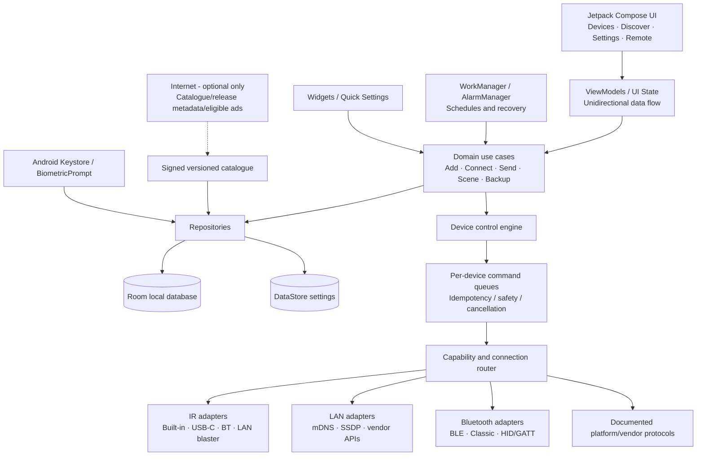

# OneRemote — Technical Architecture

| Field | Value |
|---|---|
| Document ID | UR-ARCH-001 |
| Version | 1.0 |
| Date | 2026-11-26 |
| Status | Proposed architecture; implementation not started |
| Target | Native Kotlin Android, min API 26 |

## 1. Architecture principles

1. **Local-first:** the configured remote path is entirely local. Network access is not needed for saved profiles, IR, local Wi-Fi/Bluetooth commands, scenes or UI.
2. **Capability-based, not brand-based:** a device is controllable only through an adapter that has a defined protocol and tested command mapping.
3. **Transport/protocol separation:** IR, Bluetooth, LAN and vendor command protocols are independent adapters. A brand profile may expose several possible transports.
4. **Safety by construction:** power on/off/toggle are distinct typed commands; queues enforce idempotency and no automatic retry of uncertain state-changing commands.
5. **User approval:** discovery does not equal trust. Unknown endpoints cannot become trusted silently.
6. **Offline catalogue:** essential profiles ship with the app. Optional signed catalogue updates are cached and activated only after validation and user approval.
7. **No hidden backend:** no hosted database, cloud relay, analytics endpoint or remote command service.
8. **Testable boundaries:** Android framework, Bluetooth, sockets and hardware access are isolated behind interfaces so domain logic can be tested with fakes.

## 2. High-level system diagram



## 3. Recommended project structure

Keep the first implementation modular enough to isolate hardware/protocol concerns, but avoid excessive Gradle modules before there is code. Start with one Android application module and Kotlin package boundaries; extract modules when dependency direction and build times justify it.

```text
app/
  src/main/java/<package>/
    app/                 # Application, navigation, dependency graph
    core/model/          # Pure Kotlin IDs, capabilities, statuses, commands
    core/domain/         # Use cases and domain services
    core/data/           # Room entities/DAOs, DataStore, repositories
    core/security/       # Keystore, encryption, biometric gates, import checks
    catalog/             # Bundled profiles, signed catalogue parser/updater
    connectivity/
      api/               # Transport/protocol interfaces and capability registry
      discovery/         # Discovery coordinator and consent/trust workflow
      lan/               # mDNS, SSDP, socket policies
      bluetooth/         # BLE, Bluetooth Classic, Companion Device flows
      infrared/          # ConsumerIrManager and external accessory adapters
      vendor/            # Model-specific documented APIs
    protocols/
      tv/                # TV command/profile models
      ac/                # AC full-state models and protocol encoders
      stb/               # STB/DTH commands and channel list
    features/
      devices/ discover/ remote/ scenes/ automation/ backup/ settings/ troubleshooting/
    notifications/        # Explicitly enabled reminders and automation results
    widgets/             # App widgets and Quick Settings tiles
    platform/            # Permission, lifecycle, notification, package update
  src/test/              # Pure Kotlin/unit and protocol tests
  src/androidTest/       # Device/database/Compose/transport instrumentation
config/                  # version catalog, lint, formatting
catalog/                 # source data with provenance/licence metadata
docs/                    # product and engineering specifications
```

Potential future Gradle modules: `core:model`, `core:domain`, `core:data`, `core:security`, `connectivity-api`, `transport-ir`, `transport-lan`, `transport-bluetooth`, `protocol-tv`, `protocol-ac`, `protocol-stb`, `feature-*`, `widgets`. Extract only where independent builds and dependency isolation provide a measurable benefit.

## 4. Technology choices

| Concern | Proposed choice | Notes |
|---|---|---|
| Language | Kotlin | Native Android; no cross-platform bridge for hardware APIs |
| UI | Jetpack Compose + Material 3 | Adaptive layouts, accessibility, tablet support |
| Architecture | UI/domain/data layers, MVVM state holders, unidirectional data flow | Compose state collected lifecycle-aware; domain does not depend on Android UI |
| Async | Kotlin coroutines + Flow | Per-device work scopes and cancellation |
| Local database | Room 3.x / SQLite | Structured profiles, mappings, queues, schedules and history; select stable version at coding time |
| Settings | Preferences/DataStore | Small settings, flags and user preferences |
| Background work | WorkManager for deferrable catalogue/maintenance work; AlarmManager for user-timed actions when justified | Do not claim exact timing without permission/platform support |
| Security | Android Keystore, AES-GCM field encryption, BiometricPrompt | Secrets protected; local backup policy separate from live credential storage |
| Discovery | NsdManager/mDNS, SSDP UDP adapter, Companion Device Manager where suitable | Android-version permission gating and capability-specific flows |
| IR | ConsumerIrManager; accessory-specific USB/BLE/network adapters | No generic accessory compatibility assumption |
| Release/catalogue | GitHub Releases; signed data manifest and signed APK | Internet is optional for remote functionality |
| Build/CI | Android Gradle Plugin, Gradle wrapper, Kotlin, GitHub Actions | Pin compatible stable toolchain versions at implementation start |

Google's current architecture guidance recommends a clear UI/data layering, repositories, coroutines/Flow and Jetpack Compose. Room is recommended for structured local data and provides query validation/migration support. As of the research date Room 3.0.3 is stable; versions must be pinned and checked when the build is created.

## 5. Core domain model

The core domain is pure Kotlin and must not import Android framework classes.

### 5.1 Entities

- `SavedDevice`: app-generated UUID, category, manufacturer, model, user display name, profile ID/version, preferred route, favourite flag, creation/update timestamps, last-seen timestamp, current/stale/unavailable state.
- `DeviceIdentity`: identity evidence and confidence. Store only what is needed; prefer stable protocol/device identifiers exposed by the device. IP address is an endpoint locator, not a permanent identity. Do not persist MAC address for tracking or assume Android exposes it.
- `ConnectionEndpoint`: transport type, endpoint-specific non-secret settings, security classification, protocol adapter ID and supported capabilities.
- `DeviceCapability`: typed action/features enabled for this model and verified profile.
- `CommandDefinition`: command ID, typed action, payload encoder, transport requirements, state semantics, idempotency class and repeat policy.
- `RemoteLayout`: user layout ID, button positions/sizes/labels/icons and command mappings.
- `IrSignal`: protocol name, carrier frequency, encoded value or raw alternating timings, repeat/frame parameters and provenance.
- `Scene` / `Macro`: ordered steps, target device IDs, delays, conditions, confirmation and stop-on-failure policy.
- `Schedule`: recurrence/time zone, grace-period policy, next-run calculation, enabled/paused status and linked scene/automation.
- `CommandExecution`: per-step state, transport result, timestamp, reason code and user retry eligibility.
- `CatalogueProfile`: immutable source definition with manufacturer/model aliases, protocols, commands, transport rules, source licence and verification evidence.

### 5.2 State vocabulary

Device state is separate from command-delivery state. A command may be `QUEUED`, `SENDING`, `SENT`, `CONFIRMED`, `ESTIMATED`, `FAILED`, `UNAVAILABLE` or `CANCELLED`. Device state may be `CONNECTED`, `DISCOVERED`, `SAVED_OFFLINE`, `UNAVAILABLE`, `UNKNOWN` or `STALE`. IR transmission ordinarily produces `SENT` and possibly `ESTIMATED`, not `CONFIRMED`.

## 6. Control engine and command safety

### 6.1 Typed actions

Do not represent power as an untyped toggle button. Use explicit actions such as `PowerOn`, `PowerOff` and `PowerToggle`; add `PowerToggle` only when the target protocol requires it. AC actions use stateful commands (`SetAcState(power, mode, setpoint, fan, swing, ...)`) so protocols that send a full state frame can be encoded correctly.

Each command definition includes:

- target device UUID and profile version;
- required capability and selected transport;
- idempotency (`IDEMPOTENT`, `NON_IDEMPOTENT`, `UNKNOWN`);
- whether confirmation is required;
- whether repeat is permitted;
- maximum payload/frame size and transmission bounds;
- cancellation point (before dispatch only unless transport supports safe cancellation).

### 6.2 Queue rules

- One queue per physical/logical device; a shared half-duplex transmitter has a single hardware transmit lock.
- Sequential execution within a device/half-duplex transport by default.
- Parallel execution only across independent transports/devices, with per-device result aggregation.
- Queue cancellation stops pending work. Once IR/network data has been transmitted, do not claim it was undone.
- No automatic retry for power, input switching, mode changes, channel changes or other potentially state-changing actions.
- Duplicate request suppression uses command IDs/intent windows, but never suppresses a distinct deliberate repeat command.

### 6.3 Confirmation and state estimation

A vendor API or protocol response may confirm a command only if it is an authoritative device response for that action. Sending bytes successfully is not confirmation. For one-way IR, status is unknown or estimated with a timestamp. Never infer that a TV powered on simply because the power frame was transmitted.

## 7. Transport and protocol architecture

Define two independent interfaces:

- `DeviceProtocol`: understands device semantics and encodes/decodes model/protocol commands.
- `Transport`: delivers a payload through IR, Bluetooth, LAN or an approved vendor channel and returns transport-level results.

A capability router selects a viable `(protocol, transport)` pair using model profile, detected phone hardware, discovered endpoint, security classification, signal support and user preference. Discovery adapters must not directly send appliance commands.

### 7.1 Built-in IR

Use `ConsumerIrManager` only after checking `PackageManager.FEATURE_CONSUMER_IR`, `hasIrEmitter()` and `getCarrierFrequencies()`. Its public API transmits alternating on/off microsecond timings at a selected carrier frequency and documents a maximum pattern duration under two seconds. It does not expose a general IR receive/learning API. Therefore, IR learning requires a supported external receiver/accessory; a built-in transmitter alone is insufficient.

### 7.2 External IR

Create accessory adapters by verified vendor/API/device type: USB host/serial/HID interfaces where documented, BLE/classic accessory protocols, and network IR blasters. USB-C connector shape does not imply an Android accessory protocol. BLE pairing does not imply that the accessory exposes a command API. Each supported accessory model needs transmission tests and a published compatibility entry.

### 7.3 LAN discovery/control

- mDNS/DNS-SD via Android network service discovery APIs where suitable.
- SSDP/UPnP via a bounded, local-subnet UDP adapter.
- Documented manufacturer discovery/control APIs as separate protocol adapters.
- Manual IP/port configuration only for explicitly supported protocols.
- Restrict traffic to local addresses and known service ports. No general-purpose port scanner.
- Use authentication/TLS/pairing supported by the device. Record legacy unauthenticated transports and require user-visible warnings.

Android 17/API 37 enforces `ACCESS_LOCAL_NETWORK` for apps targeting API 37+ that use LAN sockets, mDNS, SSDP and `NsdManager`. Implement an OS/target-SDK-aware permission strategy. For API 37+, request broad local-network permission only when required for full home-automation discovery/control; handle denied/revoked gracefully. Use privacy-preserving system-mediated pickers where they cover a specific use case, but do not expect a casting picker to replace the app's broad control use case.

### 7.4 Bluetooth

Support BLE and Bluetooth Classic only through documented profiles/protocols. Android 12+ uses runtime `BLUETOOTH_SCAN` and/or `BLUETOOTH_CONNECT` permissions depending on operation; legacy OS versions have different permission behavior. Consider Companion Device Manager for supported association flows. Never infer control from discovery/pairing alone. Do not advertise a universal Apple TV/Fire TV or vendor Bluetooth protocol without model-specific implementation and verification.

### 7.5 TV, STB and vendor APIs

Create independent adapter modules for Android TV/Google TV, supported vendor APIs, Fire TV or other platforms only after protocol/authentication/licensing review. TV keyboard, touchpad, app launching, standby wake and volume routing are capabilities, not assumed universal features. HDMI-CEC is generally an inter-device control path; the phone app cannot assume it can directly drive CEC without a documented endpoint or supported bridge.

### 7.6 AC protocol engine

Represent AC state as a complete model. Protocol adapters decide whether a command needs a full state frame, checksum, toggle bit, repeat frame or model-specific timing. Maintain desired state separately from observed state. Never tell the user a compressor/mode/temperature has changed unless a reliable return path confirms it.

## 8. Discovery and trust architecture

Discovery lifecycle:

1. User opens Discover or app foreground reconnect cycle begins for saved devices.
2. Permission check for the specific method.
3. Run bounded protocol-specific discovery on the active local network.
4. Normalize candidates with evidence: service type, manufacturer/model strings, endpoint, protocol, authentication availability and source.
5. Match saved identity only if evidence exceeds a defined confidence threshold.
6. Existing trusted device may be reconnected without repeated approval.
7. New or ambiguous device requires explicit user approval and protocol-aware pairing.
8. Run a non-destructive capability/test flow, then save the approved profile.

Trust is a local app state, not proof that a manufacturer authenticated the endpoint. Display the difference between secure authenticated pairing and legacy unauthenticated control. Never store plaintext passwords or access tokens.

## 9. Local persistence and backup

Use Room for structured data and DataStore for small preferences. Database is the source of truth for user-saved profiles, local command mappings, scenes/schedules and state history. Keep catalogue source profiles immutable and store user customisations as overlays so catalogue updates cannot erase user work.

Encrypt sensitive credentials/tokens with AES-GCM keys generated/stored in Android Keystore. Prefer hardware-backed keys where present, but treat hardware backing as optional. Android Keystore key material is protected from extraction, but a compromised app process may still be able to invoke permitted operations; do not overstate it as complete app compromise protection.

Backups include profile/customisation data, not necessarily live pairing secrets. Default backup is unencrypted per requirement; optional password-encrypted archive is supported. Always encrypt credentials and never export them plaintext. On a new phone, re-pair when secrets cannot be migrated. Validate import schema, archive paths, size/count limits and data version; no scripts or executable plugin code in imported profiles.

## 10. Catalogue and update architecture

- Bundle essential first-release profiles so first-use control works offline.
- Store optional expansions locally after a user-approved download.
- Manifest includes schema version, catalogue version, minimum app version, file hash, signature, created/expiry metadata and file-level licence/provenance/verification data.
- Verify digital signature using an embedded public verification key before parsing/activation.
- Reject rollback to older catalogue versions unless the user explicitly restores an exported backup with a visible warning.
- Apply updates transactionally; preserve previous active version until new set is validated.
- Custom profile overlay and user names never overwritten by catalogue updates.
- GitHub Releases may be the no-cost distribution endpoint; it is not a mandatory runtime service and the app remains usable without it.

## 11. Scheduling design

Store schedules in Room as durable definitions. Use WorkManager for deferrable maintenance and non-time-critical processing; use AlarmManager for user-specified action times when the required exact/inexact timing model is supported. Do not use a perpetual foreground service. Restore alarms after boot from stored definitions. Check exact-alarm permission before scheduling and listen for permission-state changes. Android may defer inexact work during Doze/battery restrictions. If the phone is off, local commands cannot be delivered; after reboot, skip expired actions by default and apply per-rule grace periods only when configured. A scheduled local IR action also requires the phone/accessory to be physically within range at execution time.

## 12. Widgets and Quick Settings

Widgets and tiles must invoke the same domain use cases and `CommandExecutor` as the app. They must not duplicate protocol logic. Refresh from Room state; display stale/unknown state appropriately. Respect phone unlock policy and OS restrictions. A tile/widget cannot circumvent confirmation or biometric policy for sensitive actions.

## 13. Notifications and troubleshooting

Notifications are event-driven and opt-in. Schedule reminders and automation results may notify only when the user enables the relevant category. No promotional push, continuous device-monitoring notification or automatic disconnection alert is implemented. Guided troubleshooting consumes structured error/status codes from discovery and command adapters and maps them to local help steps; it must not issue power-changing retries or upload diagnostics.

## 14. Ads and purchase boundary

The core app has no analytics. Ad integration is a separate optional adapter, default disabled until a provider's current SDK data inventory, consent requirements, manifests, identifiers, diagnostics, user interaction collection, IP processing and Play Data Safety declarations are reviewed. Non-personalised ad mode is not synonymous with zero data collection. If the provider conflicts with the privacy requirement, exclude it.

Play Billing integration is confined to the Play-distributed build. A Google Play one-time/monthly/lifetime product should be reconciled with Play Billing on the client. Without an approved server, server-side purchase-token verification cannot be assumed. Do not advertise Ad-Free purchases on sideload APK builds until there is a validated secure entitlement design. Keep the purchase subsystem independent from command control so billing outage never blocks remotes.

## 15. Build, signing and CI

- Kotlin + Android Gradle Plugin + Gradle wrapper + version catalog; pin compatible stable versions at first implementation.
- `minSdk=26`; at the research date Play submissions require `targetSdk >= 36`. Recheck current Play target policy at each release. Proactively test API 37 permission behavior.
- Lint/static checks, format, unit tests, protocol golden vectors, app build, instrumentation tests and artifact verification are mandatory CI gates.
- Feature branches and pull requests only. No direct development commits to `main`; explicit user approval before each merge.
- Signing private key kept out of repository. User owns the key; CI secrets protect signing material; offline encrypted backups retained. Use same signing identity for updates.
- GitHub Actions free-tier limits and artifact retention must be checked on setup; don't add paid services.

## 16. Dependency and licensing policy

- Prefer AndroidX/Kotlin libraries with Apache-2.0/BSD/MIT-compatible licences; record versions and notices in a dependency inventory.
- Do not import code/data solely because it is publicly visible. Audit both code and signal-data licence.
- Candidate data sources: Flipper-IRDB repository reports CC0; Flipper Devices IRDB reports MIT; still preserve source metadata and verify licence scope for every dataset/file before bundling.
- `probonopd/irdb` has a project-specific permission licence, including notice, informing the project via issue and an obligation to provide up to three licensed copies/units on request. It is not treated as a drop-in zero-cost redistributable database; do not bundle until those terms are fulfilled and accepted.
- IRremoteESP8266 is LGPL-2.1 and designed for ESP8266/ESP32. Do not embed/link it into the Android app without a legal/technical review and a decision about LGPL compliance; its existence does not make it directly usable for Android phone IR.
- Open-source protocol libraries may be used only after licence review, maintenance status check, attack-surface review and compatibility proof. The app's profile format remains independent from any single vendor library.

## 17. Main technical risks

See `DECISIONS_AND_RISKS.md`. Architecture-level blockers include non-standard accessory protocols, no universal LAN control protocol, Android 17 local-network permission, nontrivial AC full-state encodings, exact alarm restrictions, privacy-incompatible advertising SDKs, client-only purchase verification and lack of physical test hardware details.

## 18. Source references checked 2026-11-26

- Android app architecture: https://developer.android.com/topic/architecture/recommendations
- Room: https://developer.android.com/training/data-storage/room
- Room 3.0 release information: https://developer.android.com/jetpack/androidx/releases/room3
- Android local network permission/API 37: https://developer.android.com/privacy-and-security/local-network-permission
- Bluetooth permissions: https://developer.android.com/develop/connectivity/bluetooth/bt-permissions
- ConsumerIrManager: https://developer.android.com/reference/android/hardware/ConsumerIrManager
- Android Keystore: https://developer.android.com/privacy-and-security/keystore
- Biometric authentication: https://developer.android.com/identity/sign-in/biometric-auth
- Alarms and boot recovery: https://developer.android.com/develop/background-work/services/alarms
- Exact alarm restrictions: https://developer.android.com/about/versions/14/changes/schedule-exact-alarms
- Target SDK policy: https://developer.android.com/google/play/requirements/target-sdk
- Flipper-IRDB: https://github.com/Lucaslhm/Flipper-IRDB
- Flipper Devices IRDB: https://github.com/flipperdevices/IRDB
- probonopd/irdb terms: https://github.com/probonopd/irdb/blob/master/LICENSE.md
- IRremoteESP8266 licence: https://github.com/crankyoldgit/IRremoteESP8266/blob/master/LICENSE.txt